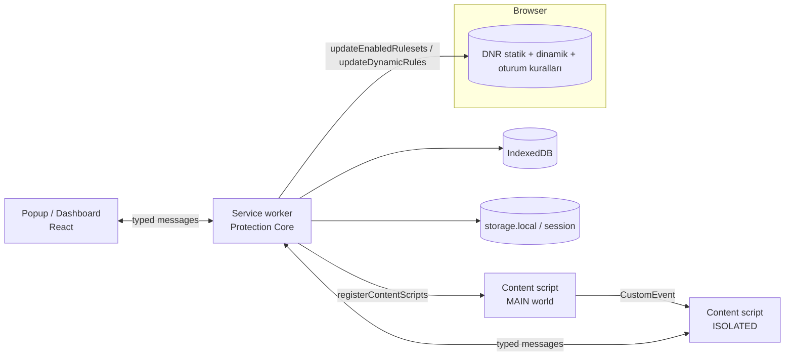

# AX Privacy — Mimari (Phase 1)

Girdiler: `EXTENSION_COMPATIBILITY_MATRIX.md`, 2026-11-01 tarihli npm sürüm kontrolü.

Öncelik sırası (proje talimatından): güvenlik > gizlilik > filtreleme doğruluğu > performans > uyumluluk > kullanıcı deneyimi.

## 1. Teknoloji seçimleri (doğrulandı)

| Bileşen                            | Sürüm     | Lisans     | Neden / not                                                                     |
| ---------------------------------- | --------- | ---------- | ------------------------------------------------------------------------------- |
| Node.js (yerel)                    | 24.22.1   | —          | Kurulu                                                                          |
| TypeScript                         | **6.0.x** | Apache-2.0 | 7.0.2 mevcut, ancak `typescript-eslint` 8.72.1 yalnızca `<6.1.0` destekliyor    |
| Vite                               | 8.3.5     | MIT        | Dashboard/popup (React) ve tüm giriş noktalarının derlemesi                     |
| @vitejs/plugin-react               | 6.1.2     | MIT        |                                                                                 |
| React                              | 19.3.1    | MIT        | Yalnızca popup ve dashboard; content script'lerde React yok                     |
| Vitest                             | 5.0.5     | MIT        | Birim testleri                                                                  |
| fake-indexeddb                     | 6.2.7     | Apache-2.0 | Yalnızca testte IndexedDB                                                       |
| Playwright                         | 1.64.1    | Apache-2.0 | Uçtan uca testler, ayrı test profili ile                                        |
| ESLint 10 + typescript-eslint 8.72 |           | MIT        |                                                                                 |
| Prettier                           | 3.9.10    | MIT        |                                                                                 |
| idb                                | 8.0.4     | ISC        | IndexedDB için ince promise sarmalayıcı (~1 KB)                                 |
| tldts                              | 7.4.19    | MIT        | eTLD+1 / public suffix: üçüncü taraf tespiti ve phishing sezgileri için zorunlu |
| @ghostery/adblocker                | 2.20.3    | MPL-2.0    | Çalışma zamanında cosmetic filtre eşleştirme (serileştirilmiş motor)            |
| @ghostery/adblocker-content        | 2.20.3    | MPL-2.0    | Content script: sayfadaki class/id/href toplama (`DOMMonitor`)                  |
| @ghostery/adblocker-extended-sel.  | 2.20.3    | MPL-2.0    | Content script: `:has-text`, `:upward` vb. gelişmiş seçicileri değerlendirme    |
| @duckduckgo/autoconsent            | 17.2.0    | MPL-2.0    | İsteğe bağlı çerez bildirimi reddi (Phase 4); değiştirilmeden kullanılıyor      |

Ağ filtresi → DNR derleyicisi projenin kendi kodu (`src/engines/adblock/network.ts`). Phase 3'te düşünülen `@adguard/tsurlfilter`, bağımlılığı `js-yaml` yüksek önem dereceli açık taşıdığı için alınmadı.

**Reddedilenler:**

- `@crxjs/vite-plugin`: Firefox çıktısı için ayrı manifest dönüşümü gerekiyor ve tek bir ince build betiği yeterli. Bir bağımlılık az.
- `webextension-polyfill`: Hedef Firefox sürümleri `chrome.*` ad alanını promise tabanlı olarak destekliyor.
- Tailwind: Dashboard'da düz CSS modülleri yeterli.

**Proje lisansı: GPL-3.0-or-later.** Kullanılacak filtre listelerinin çoğu (EasyList, EasyPrivacy, uBlock filters, AdGuard filtreleri) GPL-3.0. Çıktıları paketleyen eklentinin de GPL uyumlu olması gerekiyor. MPL-2.0 (Ghostery adblocker) GPL ile uyumlu.

## 2. Çalışma zamanı mimarisi



### Protection Core (service worker)

MV3 service worker 30 saniye boşta kaldıktan sonra kapanabilir. Bu nedenle bellekte tutulan her şey, `storage.session` ya da IndexedDB'den tembel (lazy) yüklenerek yeniden kurulabilir olmalı. Global değişkenlerde kalıcı durum tutulmaz.

Sorumlulukları:

- Ayarlar ve site profilleri (`storage.local`).
- DNR ruleset etkinleştirme ve kota kontrolü.
- Site bazlı duraklatma ve modül profili: dinamik `allowAllRequests` / `allow` kuralları.
- Scriptlet / MAIN-world betiklerinin `scripting.registerContentScripts` ile kaydı.
- İstatistik toplama (Phase 7: `background/stats.ts`, IndexedDB `stats` + yerel güvenlik günlüğü).
- Skorlama ve öneri motoru.
- Filtre listesi güncellemeleri (`alarms`).

### Content script'ler

| Betik                    | Dünya    | Zaman            | İş                                                                                                   |
| ------------------------ | -------- | ---------------- | ---------------------------------------------------------------------------------------------------- |
| `content/cosmetic.ts`    | ISOLATED | `document_start` | Background'dan siteye özel cosmetic CSS ve prosedürel kuralları alır, `<style>` olarak uygular       |
| `content/scriptlets.ts`  | MAIN     | `document_start` | Yalnızca o sitede eşleşen scriptlet'leri çalıştırır (listeden gelen, paket içi kod; uzaktan kod yok) |
| `content/fingerprint.ts` | MAIN     | `document_start` | Fingerprinting API çağrılarını **sayar**; koruma açıksa gürültü ekler                                |
| `content/security.ts`    | ISOLATED | `document_idle`  | Sayfa sinyalleri: şifre alanı, form action, sahte login göstergeleri                                 |
| `content/popup-guard.ts` | MAIN     | `document_start` | `window.open` çağrılarını kullanıcı etkileşimi + `$popup` filtre eşleşmesiyle değerlendirir          |

Hiçbir content script `challenges.cloudflare.com` üzerinde çalışmaz (`exclude_matches`). Turnstile bozulması Kalkan projesinde yaşanmıştı.

### Mesajlaşma

- Tek bir ayrışık birleşim (discriminated union) tipi `shared/messages.ts` içinde tanımlanır. Her mesaj `{ type, payload }` biçimindedir; dönüş tipi tipe bağlıdır.
- Background her mesajda `sender.id === chrome.runtime.id` kontrolü yapar. UI mesajları için `sender.url` eklentinin kendi origin'i olmalı. Content script mesajları yalnızca okuma ve rapor türlerini kullanabilir.
- `runtime.onMessageExternal` dinlenmez. `externally_connectable` tanımlanmaz.
- MAIN world ile ISOLATED arasındaki iletişim, rastgele adlandırılmış bir `CustomEvent` ile yapılır. Gelen veri sayfa tarafından sahtelenebileceği için yalnızca istatistik amaçlıdır; hiçbir karar buna dayanmaz.

## 3. Modüller

| Modül                    | Klasör                  | Mekanizma                                                                                                                  | MV3 notu                                                                                           |
| ------------------------ | ----------------------- | -------------------------------------------------------------------------------------------------------------------------- | -------------------------------------------------------------------------------------------------- |
| Ad blocking (ağ)         | `engines/adblock`       | Derleme zamanında DNR statik rulesetleri                                                                                   | Varsayılan etkin toplam ≤ 30.000 kural (garanti kotası; audit'e göre global havuzun %67'si dolu)   |
| Cosmetic filtreleme      | `engines/adblock`       | `@ghostery/adblocker` serileştirilmiş motor → site CSS'i                                                                   | Genel gizleme kuralları ayrı ve kapatılabilir (GitHub bozulması dersi)                             |
| Custom filtreler         | `engines/adblock`       | Kullanıcı kuralı → paket içi derleyici → dinamik DNR; gizleme kuralları → cosmetic motor                                   | Dinamik kural limiti: 30.000 (AX 29.000 kullanır), regex en fazla 1.000                            |
| Tracker blocking         | `engines/tracker`       | EasyPrivacy DNR + Disconnect kategorileri (raporlama)                                                                      |                                                                                                    |
| Cookie / consent         | `engines/cookie`        | Cookie banner gizleme listesi (cosmetic). Otomatik "reddet" yalnızca kullanıcı açarsa                                      | Kullanıcı tercihi izinsiz değiştirilmez                                                            |
| Fingerprinting           | `engines/fingerprint`   | MAIN world API sayımı + opsiyonel canvas/audio/WebGL gürültüsü, eTLD+1 başına oturum tohumu                                | Brave'de varsayılan kapalı (Brave zaten "farbling" yapıyor; çift gürültü siteleri bozar)           |
| Popup / redirect         | `engines/popup`         | `popup-guard` + `webNavigation.onCreatedNavigationTarget`; sekme yalnızca hedef URL `$popup` filtresiyle eşleşirse kapanır | DNR `$popup` desteklemiyor. Orta tık / Ctrl+tık ile açılan sekmeye asla dokunulmaz (Kalkan hatası) |
| YouTube                  | `engines/video/youtube` | Scriptlet (JSON prune vb., liste kaynaklı) + DNR + cosmetic                                                                | DRM'e dokunulmaz                                                                                   |
| Twitch                   | `engines/video/twitch`  | DNR (reklam/izleme uç noktaları) + cosmetic                                                                                | Stitched reklamlar DNR ile engellenemiyor; bkz. Açık kararlar                                      |
| Anti-phishing / malware  | `security/`             | Yerel blok listeleri (IndexedDB, hash'lenmiş host seti) + `main_frame` için DNR yönlendirme → uyarı sayfası                | Uyarı sayfası "yine de devam et" seçeneği sunar ve oturum bazında izin verir                       |
| Scam / trust             | `security/reputation`   | Yerel sezgiler + opsiyonel RDAP alan adı yaşı                                                                              | RDAP sorgusu alan adını üçüncü tarafa gönderir: **yalnızca kullanıcı tıklarsa** yapılır            |
| Filter List Manager      | `filters/`              | Paket içi listeler (DNR) + kullanıcının açtığı ek listeler (indirilir, dinamik kurala dönüştürülür)                        | İndirilen liste uzaktan **kod** değildir; scriptlet'ler yalnızca paket içi kütüphaneden çalışır    |
| Site profilleri          | `storage/profiles`      | eTLD+1 başına: kapalı / standart / sıkı + modül bazlı geçersiz kılmalar                                                    |                                                                                                    |
| Brave Compatibility Mode | `engines/compat`        | `navigator.brave.isBrave()` ile tespit; uyumlu varsayılanlar; çakışma önerileri                                            | Shields durumu API ile okunamaz; kullanıcı beyanı istenir                                          |

## 4. Dual-Score sistemi

İki skor ve bir güven değeri hesaplanır. Hepsi yalnızca yerel ve gözlemlenmiş veriden üretilir. Veri yoksa skor gösterilmez ve sonuç "Bilinmiyor" olur. Veri olmaması asla "güvenli" sayılmaz.

**Privacy Score (0–100, yüksek = daha gizli)**

- Girdiler (sekme başına):
  - Engellenen ve izin verilen üçüncü taraf istekleri, Disconnect kategorisine göre.
  - Tespit edilen fingerprinting API çağrıları.
  - Bağlantının HTTPS olup olmadığı.
- Hesaplama: 100'den başlanır, her kategori için ağırlıklı ceza düşülür. Ağırlıklar `engines/scoring/weights.ts` içinde sabit tutulur ve testlenir.

**Security Risk Score (0–100, yüksek = daha riskli)**

- Yerel blok listesi eşleşmesi: ≥ 90.
- Sezgiler:
  - punycode / homoglyph
  - IP host
  - aşırı alt alan adı
  - marka adı + farklı eTLD+1
  - HTTP üzerinde şifre alanı
  - farklı origin'e giden login form'u
  - kullanıcı sorguladıysa genç alan adı (RDAP)
- Liste eşleşmesi yoksa, en fazla 70 ile sınırlı ağırlıklı toplam kullanılır.

**Confidence (Düşük / Orta / Yüksek)**

- Kaç sinyal kaynağının gerçekten mevcut olduğuna göre belirlenir: listeler yüklü mü, sayfa tamamlandı mı, content script çalıştı mı, RDAP sorgulandı mı?
- Örnek: yalnızca URL sezgisi varsa güven "Düşük" olur.

**UI dili:** "Bilinen tehdit bulunamadı" kullanılır, "Güvenli" kullanılmaz.

**Öneri motoru:** Kural tabanlıdır (ör. "Bu sitede 12 izleyici izinli → sıkı profil öner"). Her öneri tek tıkla uygulanabilir ve geri alınabilir. Hiçbir öneri otomatik uygulanmaz.

## 5. Depolama

| Veri                                                                      | Yer                 | Saklama süresi                                      |
| ------------------------------------------------------------------------- | ------------------- | --------------------------------------------------- |
| Ayarlar, site profilleri, kullanıcı filtreleri                            | `storage.local`     | Kullanıcı silene kadar                              |
| Sekme başına anlık sayaçlar, oturum izinleri                              | `storage.session`   | Tarayıcı oturumu                                    |
| Günlük toplam istatistik (kategori bazında sayılar), site bazında sayılar | IndexedDB `stats`   | Varsayılan 30 gün; ayarlanabilir, tek tıkla silinir |
| Serileştirilmiş cosmetic motor, tehdit host setleri, indirilen listeler   | IndexedDB `engines` | Liste güncellenince değişir                         |

Hiçbir veri cihaz dışına gönderilmez. Tek ağ çağrıları şunlardır: kullanıcının açtığı filtre listesi güncellemeleri ve kullanıcının tıkladığı RDAP sorgusu. Telemetri yoktur.

## 6. İstatistik doğruluğu (MV3 kısıtı)

- `webRequest` üzerinden görülen `ERR_BLOCKED_BY_CLIENT` hatasının hangi engelleyiciden geldiği ayırt edilemez. Audit'e göre Brave'de 5 engelleyici + Shields çalışıyor. Bu nedenle sayılar yalnızca `declarativeNetRequest.getMatchedRules()` ile alınır (izin: `declarativeNetRequestFeedback`).
- Kısıt: Bu çağrı 10 dakikada 20 kez ile sınırlı (kullanıcı hareketi hariç). Plan:
  - `alarms` ile en sık 30 saniyede bir `minTimeStamp` ile artımlı okuma yapılır.
  - Popup açılınca anlık okuma yapılır.
- Cosmetic gizlemeler ayrı sayılır (content script raporu). Ağ engellemeleriyle toplanmaz.
- Yalnızca AX'in kendi engellediği gösterilir. Uydurma "kaydedilen MB / zaman" metrikleri yoktur.

## 7. İzinler

| İzin                                                     | Neden                                                                          |
| -------------------------------------------------------- | ------------------------------------------------------------------------------ |
| `declarativeNetRequest`, `declarativeNetRequestFeedback` | Engelleme + gerçek eşleşme istatistiği                                         |
| `storage`, `unlimitedStorage`                            | Ayarlar + IndexedDB'deki listeler                                              |
| `scripting`                                              | MAIN world scriptlet kaydı                                                     |
| `tabs`, `webNavigation`                                  | Sekme bazlı skor, popup koruması                                               |
| `alarms`                                                 | Liste güncelleme, istatistik okuma                                             |
| `contextMenus`                                           | Öğe seçici ("bu öğeyi engelle")                                                |
| host: `http://*/*`, `https://*/*`                        | Cosmetic/scriptlet enjeksiyonu                                                 |
| opsiyonel `management`                                   | Çakışan eklentileri listelemek; yalnızca kullanıcı uyumluluk ekranında isterse |

İstenmeyen izinler: `cookies`, `history`, `webRequestBlocking`, `nativeMessaging`, `identity`, `userScripts`.

## 8. Tarayıcı uyumluluğu

| Konu                      | Chrome / Brave / Edge   | Firefox                                      | Çözüm                            |
| ------------------------- | ----------------------- | -------------------------------------------- | -------------------------------- |
| Background                | `service_worker`        | `background.scripts` (event page)            | Build betiği iki manifest üretir |
| DNR statik / dinamik      | Var                     | Var (113+)                                   | Aynı rulesetler                  |
| `getMatchedRules`         | Var                     | Var                                          |                                  |
| MAIN world content script | Var                     | 128+                                         | `strict_min_version: "128.0"`    |
| `navigator.brave`         | Yalnız Brave            | Yok                                          | Brave modu otomatik kapalı       |
| Eklenti ID                | Store tarafından atanır | `browser_specific_settings.gecko.id` gerekli | Manifest dönüşümü ekler          |

`public/manifest.json` Chromium manifestidir. `scripts/build.ts` bundan `dist/chrome` ve `dist/firefox` çıktılarını üretir.

## 9. Kaynak lisansları (Phase 3 listeleri `docs/PHASE_3_ADBLOCK.md`'de doğrulandı; güvenlik listeleri Phase 5'te)

| Kaynak                            | Lisans                   | Kullanım                                                             |
| --------------------------------- | ------------------------ | -------------------------------------------------------------------- |
| EasyList, EasyPrivacy             | GPL-3.0 / CC BY-SA 3.0   | Paket içi DNR                                                        |
| uBlock filters, uBlock badware    | GPL-3.0                  | Paket içi DNR                                                        |
| AdGuard Base / Tracking / Turkish | GPL-3.0                  | Opsiyonel liste                                                      |
| URLhaus (abuse.ch)                | CC0 (malware-filter MIT) | Malware alan adları, `urlhaus-filter-domains-online` (Phase 5)       |
| OpenPhish / phishing-filter       | Ticari kullanım yasak    | **Dahil değil** (OpenPhish koşulları yeniden dağıtımı yasaklıyor)    |
| PhishTank                         | Kayıt + API anahtarı     | **Dahil değil**                                                      |
| Disconnect tracker list           | GPL-3.0                  | Tracker kategorileri                                                 |
| Peter Lowe's list                 | Kullanım koşulu belirsiz | **Doğrulanana kadar dahil değil**                                    |
| Phishing Army                     | CC BY-NC 4.0             | GPL ürünle uyumsuz, **dahil değil**                                  |
| SponsorBlock API                  | CC BY-NC-SA 4.0          | İsteğe bağlı, varsayılan kapalı; yalnızca 4 karakterlik özet öneki   |
| Google Safe Browsing              | API anahtarı + koşullar  | Dahil değil; Brave zaten kendi proxy'li Safe Browsing'ini kullanıyor |

## 10. Klasör yapısı

Klasörler Phase 2'de içleri gerçek dosyalarla birlikte oluşturulacak. Boş klasör veya iskelet dosya bırakılmayacak.

```
public/
  manifest.json            Chromium manifesti (kaynak)
  icons/                   16/32/48/128 PNG (kullanıcının logosundan)
scripts/
  build.ts                 Vite derlemeleri + chrome/firefox manifest çıktısı
  filters.ts               Liste indir → DNR rulesetleri + popup kuralları + cosmetic motor (.bin)
src/
  background/              Service worker girişi, mesaj yönlendirici, alarm işleyicileri
  content/                 Bölüm 2'deki 5 betik
  engines/
    adblock/  tracker/  cookie/  fingerprint/  popup/
    video/youtube/  video/twitch/
    scoring/               Privacy, risk, confidence, öneriler
    compat/                Brave modu, çakışma tespiti
  filters/                 Liste kataloğu, güncelleme, kota yönetimi
  security/                phishing/, malware/, reputation/
  storage/                 settings, profiles, stats (idb)
  dashboard/               React: popup + dashboard sayfaları
  shared/                  messages.ts, types.ts, url.ts (tldts sarmalayıcı)
  tests/                   Vitest birim testleri (modül başına)
e2e/                       Playwright testleri + yerel simüle sayfalar
docs/
```

## 11. Geliştirme planı

| Phase          | Çıktı                                                                                | Bitti sayılma ölçütü                                                                                        |
| -------------- | ------------------------------------------------------------------------------------ | ----------------------------------------------------------------------------------------------------------- |
| 2 Core         | Manifest, service worker, mesajlaşma, storage, build betiği, ikonlar                 | `tsc`, ESLint, Vitest yeşil; Brave'e paketlenmemiş yükleniyor, popup açılıyor ve site açma/kapama çalışıyor |
| 3 Ad blocking  | compile-filters, DNR rulesetleri, cosmetic motor, custom filtreler, liste yöneticisi | Yerel test sayfasında bilinen reklam URL'si engelleniyor; kota testi geçiyor                                |
| 4 Privacy      | Tracker, cookie banner, fingerprint                                                  | API sayımı birim testli; Brave'de fingerprint varsayılan kapalı                                             |
| 5 Security     | Phishing/malware listeleri, uyarı sayfası, sezgiler, Dual-Score                      | Simüle URL'lerle skor testleri; boş veri = "Bilinmiyor" testi                                               |
| 6 Video        | YouTube scriptlet'leri, Twitch DNR + cosmetic                                        | Kaydedilmiş JSON örnekleri üzerinde birim testleri                                                          |
| 7 Dashboard    | İstatistik, site ayarları, liste yöneticisi, güvenlik raporu, öneriler               | Her buton gerçek bir mesajı tetikliyor (Playwright)                                                         |
| 8 Optimizasyon | Bellek/CPU ölçümü, motor önbelleği                                                   | Ölçülen değerler belgelenmiş                                                                                |
| 9 Test         | E2E, güvenlik denetimi, uyumluluk (ayrı profilde AdGuard / uBO Lite ile)             | Matristeki tahmini seviyeler ölçümle güncellenmiş                                                           |
| 10 Release     | Chrome/Firefox zip, gizlilik politikası, kurulum talimatı                            | Temiz kurulumda çalışıyor                                                                                   |

## 12. Açık kararlar

1. **Twitch stitched reklamları:**
   - Twitch reklamları video akışının (m3u8) içine gömüyor. DNR bunları engelleyemez.
   - Twitch Adblock'un yöntemi m3u8 yanıtlarını değiştirip farklı oynatıcı türüyle yedek akış almak. Bu, proje kurallarındaki "platform mekanizmalarını aşan trafik müdahalesi" sınırına yakın.
   - Öneri: Phase 6'da varsayılan olarak yalnızca DNR + cosmetic kullanmak. m3u8 filtrelemesini ayrı, açıkça etiketli ve varsayılan kapalı bir seçenek olarak tutmak. Kullanıcı onayı Phase 6 başında istenecek.
2. **Chrome Web Store dağıtımı:** `declarativeNetRequestFeedback` ve geniş host izinleri incelemede gerekçe ister. Mağaza yayını hedefleniyorsa gerekçe metni Phase 10'da hazırlanır.
